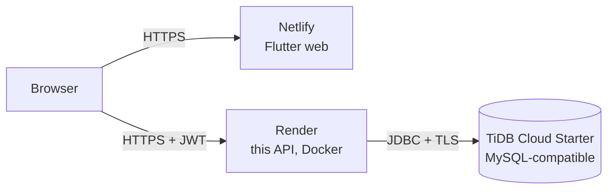
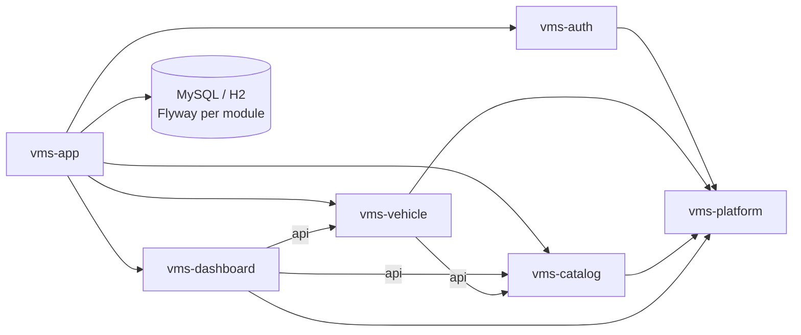

# Datavvy VMS — Backend (REST API)

The API for **Datavvy VMS**, a vehicle management system for a company fleet. It's a **modular monolith** in Spring Boot, so several teams (and AI coding agents) can extend it module by module without stepping on each other.

**Stack:** Java 21 · Spring Boot 3.5 · Spring Security (JWT) · Spring Data JPA · Flyway · MySQL 8 (H2 in MySQL mode for tests) · OpenAPI · Docker

**Web app:** [datavvy-vms-frontend](https://github.com/MoZahidUl249/datavvy-vms-frontend) (Flutter web), which calls this API.

| | |
|---|---|
| Tests | `mvn verify`: unit, HTTP integration, architecture (ArchUnit) and config-hygiene tests |
| Hosting | Render (Docker, free plan) · database on TiDB Cloud Starter (MySQL-compatible, free) |
| API docs | Swagger UI at `/swagger-ui.html` · reference in [`API.md`](API.md) · contract in [`contracts/openapi/vms-api.yaml`](contracts/openapi/vms-api.yaml) |

---

## Contents

1. [What the API does](#what-the-api-does)
2. [Run it locally](#run-it-locally)
3. [Configuration](#configuration)
4. [Deploy (Render + TiDB Cloud)](#deploy-render--tidb-cloud)
5. [API](#api)
6. [Architecture](#architecture)
7. [Design decisions and trade-offs](#design-decisions-and-trade-offs)
8. [Testing](#testing)
9. [Agentic workflow](#agentic-workflow)
10. [Known limitations and roadmap](#known-limitations-and-roadmap)
11. [Repository map](#repository-map)

---

## What the API does

Every vehicle has exactly **Vehicle Number, Company, Type, Brand, Model, Status**.

| Feature | Details |
|---|---|
| **CRUD** | `/api/v1/vehicles`: create (201 + `Location`), list with filters/paging/sort, get, update, delete (204). JSON DTOs, never database entities |
| **Duplicate Vehicle Number rule** | A number can exist only once. `dha metro ga 11 4582` and `DHA-METRO-GA 11-4582` are the same vehicle. Enforced in the service layer and by a database `UNIQUE` constraint; rejected with **409 `DUPLICATE_VEHICLE_NUMBER`** |
| **Validation** | 400 with a message per field that says how to fix it ("Enter the model, like Hiace.") |
| **Status** | `ACTIVE` / `INACTIVE` / `MAINTENANCE` (enum + database `CHECK`) |
| **Managed vehicle types** | Type must be one of the catalog types; types in use can't be renamed or removed |
| **Safe concurrent edits** | Optimistic locking: a stale `version` gets 409 `STALE_VERSION` |
| **Dashboard** | One summary call: totals by status, by type, by brand, recently updated, in maintenance |
| **Roles** | Admin (everything) · Fleet manager (vehicles) · Viewer (read only, 403 on writes) |

---

## Run it locally

Prerequisites: **JDK 21+** (the scripts download Maven if it's missing). Docker or MySQL is optional.

**One click (macOS):** double-click **`run-backend.command`**. It creates `.env` with random local passwords on first run, uses MySQL if one is running (or starts it in Docker), otherwise a local **H2** file database, then starts the API on **http://localhost:8080** with demo data.

| Script | Does | Log |
|---|---|---|
| `run-backend.command` | API with demo data | `backend-run.log` |
| `run-backend-tests.command` | `mvn verify` | `backend-tests.log` |
| `test-api.command` | curl run-through: login → create → list → get → update → duplicate (409) → validation (400) → delete | `api-test.log` |

**Manual:**

```bash
cp .env.example .env && $EDITOR .env      # or let run-backend.command create it
set -a; . ./.env; set +a

docker compose up -d mysql                # optional — skip and use the h2 profile
mvn install -DskipTests
mvn -f vms-app/pom.xml spring-boot:run -Dspring-boot.run.profiles=local       # MySQL
mvn -f vms-app/pom.xml spring-boot:run -Dspring-boot.run.profiles=local,h2    # no MySQL
```

**Containers:** `docker compose --profile full up -d --build` → MySQL + API on http://localhost:8080.

**Demo accounts** (`demo` and `local` profiles):

| Email | Password | Role |
|---|---|---|
| `admin@datavvy.com` | `Admin@12345` | Admin |
| `manager@datavvy.com` | `Manager@12345` | Fleet manager |
| `viewer@datavvy.com` | `Viewer@12345` | Viewer |

---

## Configuration

Credentials are never in the repo. The API reads them from environment variables and **refuses to start if one is missing**; there are no fallback values, and `ConfigHygieneTest` fails the build if one is added. Locally, the scripts and `docker compose` read a git-ignored `.env` (template: [`.env.example`](.env.example)).

| Variable | Required | Purpose |
|---|---|---|
| `VMS_DB_URL`, `VMS_DB_USER`, `VMS_DB_PASSWORD` | Yes (not with the `h2` profile) | MySQL connection |
| `VMS_JWT_SECRET` | Yes | Signs login tokens; 32+ random characters (`openssl rand -base64 48`) |
| `VMS_CORS_ORIGINS` | No — default `http://localhost:*,http://127.0.0.1:*` | Browser origins allowed to call the API (comma-separated, `*` wildcards) |
| `SPRING_PROFILES_ACTIVE` | No | `demo` = demo users and vehicles · `local` = `demo` + debug logs · `h2` = file database instead of MySQL |
| `PORT` | No — default `8080` | HTTP port (Render sets it) |
| `VMS_DB_POOL` | No — default `10` | Connection pool size |

Health: `/actuator/health` (overall) and `/actuator/health/readiness` (includes the database).

---

## Deploy (Render + TiDB Cloud)



Everything runs on free plans with no credit card.

1. **Database:** create a free TiDB Cloud **Starter** cluster (AWS Singapore is closest to Render's Singapore region). From **Connect → Java**, note the host and user.
2. **API:** Render → New → **Blueprint** → this repo. [`render.yaml`](render.yaml) sets the Docker build, free plan, Singapore region, health check, the `demo` profile and JVM flags for 512 MB, and generates `VMS_JWT_SECRET`. Fill in:
   - `VMS_DB_URL` = `jdbc:mysql://<host>:4000/vms?sslMode=VERIFY_IDENTITY&createDatabaseIfNotExist=true`
   - `VMS_DB_USER`, `VMS_DB_PASSWORD` (from TiDB)
   - `VMS_CORS_ORIGINS` = the Netlify site URL
3. Flyway creates the schema and demo data on first start. Check `https://<service>.onrender.com/actuator/health`.

**Free-tier notes:** the Render free instance sleeps after 15 idle minutes, so the next request takes about a minute. TiDB hands out `AUTO_INCREMENT` ids in batches, so ids can jump (e.g. 1 → 30001); nothing depends on them being consecutive. The `demo` profile loads public demo accounts; remove it for real data.

---

## API

Full reference with examples: **[`API.md`](API.md)** · contract: [`contracts/openapi/vms-api.yaml`](contracts/openapi/vms-api.yaml) · Postman: [`postman/`](postman) · curl: [`scripts/api-smoke.sh`](scripts/api-smoke.sh).

| Method | Path | Success | Errors |
|---|---|---|---|
| POST | `/api/v1/auth/login` | 200 token | 400, 401 |
| POST | `/api/v1/vehicles` | 201 + `Location` | 400, 403, **409 `DUPLICATE_VEHICLE_NUMBER`** |
| GET | `/api/v1/vehicles` (filters, paging, sort) | 200 page | 401 |
| GET | `/api/v1/vehicles/{id}` | 200 | 404 |
| PUT | `/api/v1/vehicles/{id}` | 200 | 400, 404, 409 duplicate / `STALE_VERSION` |
| DELETE | `/api/v1/vehicles/{id}` | 204 | 403, 404 |
| GET | `/api/v1/vehicles/facets`, `/api/v1/vehicles/number-check` | 200 | UI helpers |
| GET/POST/PATCH/DELETE | `/api/v1/catalog/vehicle-types` | | 409 `CATALOG_ITEM_IN_USE`, 422 `CATALOG_KEEP_ONE` |
| GET | `/api/v1/dashboard/summary` | 200 | |

Every error has the same shape (RFC 9457 problem document), and clients branch on `code`, never on the message:

```json
{ "status": 409, "code": "DUPLICATE_VEHICLE_NUMBER",
  "detail": "A vehicle with number DHA-METRO-GA 11-4582 already exists.",
  "details": { "field": "vehicleNumber", "vehicleNumber": "DHA-METRO-GA 11-4582", "existingId": 1 } }
```

### How the duplicate rule works

1. **Service, on save:** `VehicleService.rejectDuplicate()` runs on create and update (an update may keep its own number) and throws `DuplicateVehicleNumberException` → 409.
2. **Database, as a backstop:** `UNIQUE (vehicle_number_key)`. If two saves race past step 1, the constraint fires and the service maps it to the same 409, so no SQL error reaches the client.
3. **Before saving:** `GET /vehicles/number-check` lets the web app warn while the user types.

### Data model — `vehicle`

| Field | Column | Type | Rules |
|---|---|---|---|
| id | `id` | `BIGINT AUTO_INCREMENT` PK | Generated |
| Vehicle Number | `vehicle_number` | `VARCHAR(32)` | Canonical form `DHA-METRO-GA 11-4582` |
| — | `vehicle_number_key` | `VARCHAR(32)` **UNIQUE** | Uppercase, spaces and hyphens removed (`DHAMETROGA114582`) |
| Company | `company` | `VARCHAR(100)` | Required |
| Type | `type` | `VARCHAR(60)` | A catalog vehicle-type name |
| Brand | `brand` | `VARCHAR(60)` | Required |
| Model | `model` | `VARCHAR(60)` | Required |
| Status | `status` | `VARCHAR(20)` + `CHECK` | `ACTIVE`, `INACTIVE`, `MAINTENANCE` |
| Audit | `created_at`, `updated_at`, `created_by`, `updated_by` | `DATETIME(6)` UTC / `VARCHAR` | Filled automatically |
| Version | `version` | `BIGINT` | Optimistic locking |

---

## Architecture



| Module | Owns | Public API to other modules |
|---|---|---|
| `vms-platform` | Error model (RFC 9457 + `code`), paging envelope, auditing base entity, roles | Shared kernel |
| `vms-auth` | Users, login, JWT, security filter chain | `auth.api` |
| `vms-catalog` | Vehicle types (`catalog_item`) | `CatalogLookup`, `CatalogUsageProvider` (an extension point vehicle implements) |
| `vms-vehicle` | Vehicles, CRUD, the duplicate rule | `VehicleQueryApi` |
| `vms-dashboard` | Read-only summary; no tables | `dashboard.api` |
| `vms-app` | Boot class, configuration, demo seed data, cross-module tests | — |

Each module: `api/` (public records and interfaces) · `web/` (controllers) · `application/` (services, rules) · `domain/` (entities, repositories) · `config/`. More in [`docs/architecture.md`](docs/architecture.md) and [`docs/adr/`](docs/adr).

---

## Design decisions and trade-offs

| # | Decision | Why | Trade-off | Revisit when |
|---|---|---|---|---|
| 1 | **Modular monolith** (one Spring Boot app, Maven module per domain) | Parallel teams with clear ownership; one build, one deploy, one transaction | One bad release ships every module; modules scale together | A module needs its own scaling or release cadence → extract it |
| 2 | **Modules talk only through `api` packages**, enforced by ArchUnit | Boundaries are real, not a convention | More interfaces and records; `api` changes need the owner's review | Never — it keeps extraction possible |
| 3 | **No foreign keys across modules**; `vehicle.type` stores the type *name* | Modules own their tables; matches the single `Type` field | The service validates the type; the catalog blocks renaming types in use | Renaming types becomes a need → store the id plus a display name |
| 4 | **Contract-first OpenAPI** in `contracts/` | Frontend and backend agree before building | YAML kept in sync by hand (springdoc helps spot drift) | Generate clients or contract tests in CI |
| 5 | **Duplicate rule in service + `UNIQUE` on a normalised key** (+ live check in the UI) | The rule lives in the business layer; races are still safe | Several places to keep in step (shared test cases) | — |
| 6 | **Separate normalised key column** instead of a functional index | Portable across MySQL, TiDB and H2 | One extra column, kept in sync by the entity | MySQL-only → generated column |
| 7 | **Status as enum string + `CHECK`** | Readable, rejected at API and database level | New status needs a migration | User-defined statuses → catalog list |
| 8 | **Hard delete** | Matches the Delete step; simple uniqueness | No undo or history | Audit needed → soft delete or audit log |
| 9 | **Optimistic locking** (`version`) | No silent overwrites | Client sends `version`; user may reload | — |
| 10 | **Stateless JWT (HS256)**, roles in the token | No server sessions; easy to scale | Can't revoke before expiry; one shared secret | SSO → OIDC provider with refresh tokens |
| 11 | **RFC 9457 problem documents with a stable `code`** | One error shape; no internals leak | Every failure needs a documented code | — |
| 12 | **Flyway: folder per module, timestamp versions, out-of-order** | Teams never fight over version numbers | Append-only discipline | — |
| 13 | **H2 (MySQL mode) for tests and as a no-MySQL fallback** | Tests run anywhere in seconds | Not 100% MySQL behaviour | Testcontainers MySQL in CI |
| 14 | **No credential fallbacks; `.env` locally, env vars on servers** | A missing variable stops the app instead of running with a known password | One-time `.env` setup (scripts automate it) | Secrets manager when there are more environments |
| 15 | **Render free + TiDB Cloud Starter** | Free, no card; MySQL-compatible | Cold starts after 15 idle minutes; TiDB isn't byte-for-byte MySQL | Paid instance or managed MySQL for real users |
| 16 | **Spring Boot 3.5 rather than 4.0** | Familiar baseline; avoids Jackson 3 churn | Upgrade later (ADR-0006) | After phase 1 |
| 17 | **Filter-calendar dates computed in Java** | Simple and portable | Loads every timestamp per request | Large fleets → `GROUP BY DATE(...)` |

---

## Testing

| Suite | Where | Covers |
|---|---|---|
| `VehicleServiceTest` | `vms-vehicle` (Mockito) | Duplicate on create and update, keeping your own number, the race backstop, field errors, stale version |
| `VehicleNumberTest` | `vms-vehicle` | Plate parsing, canonical form, normalised key |
| `VehicleApiIntegrationTest` | `vms-app` (HTTP + H2 + Flyway) | 201/200/200/204/404, duplicate 409 on create and update, the database constraint alone, 400 validation, bad enum, 409 stale version, viewer 403 |
| `VmsApiIntegrationTest` | `vms-app` | Login, token required, catalog, dashboard, current user |
| `ArchitectureTest` | `vms-app` (ArchUnit) | Module boundaries, platform independence, layering |
| `ConfigHygieneTest` | `vms-app` | No credential fallbacks or literal secrets in any profile |

```bash
mvn verify                    # or double-click run-backend-tests.command
bash scripts/api-smoke.sh     # live run-through (API must be running)
```

CI (GitHub Actions) runs `mvn verify` and a Docker build on every push and pull request.

---

## Agentic workflow

Set up for **Google Antigravity** (also works with Claude Code, Codex and Cursor):

```
AGENTS.md              always loaded: stack, golden rules, commands, definition of done
.agents/rules/*.md     loaded by file pattern (Java, migrations, API contract) + always-on guardrails
.agents/skills/        playbooks, each also a /slash-command
.agents/agents/        read-only reviewer subagents
```

| Command | Use it to |
|---|---|
| `/plan-feature` | Turn a request into a module-by-module plan; stops for approval when it crosses modules |
| `/new-backend-module` | Scaffold a new area (e.g. maintenance) wired into Maven, Flyway, ArchitectureTest and CODEOWNERS |
| `/api-change` | Change the contract first, then Java, then tell the frontend repo |
| `/db-migration` | A safe migration that runs on MySQL and H2 (expand/contract) |
| `/verify` · `/pr-ready` | Evidence-based checks; reviewer subagents; PR description |

Reviewer subagents (`architecture-reviewer`, `contract-guardian`, `qa-verifier`) never edit files, so the agent that wrote the code isn't the one grading it. Guardrails: agents touch only the modules a task names, never edit an applied migration, never weaken a test, and never commit secrets; `ArchitectureTest`, `ConfigHygieneTest`, CI and CODEOWNERS catch what slips through.

---

## Known limitations and roadmap

- No rate limiting on login; no audit log yet.
- Tokens can't be revoked before they expire (8 h).
- **1.1:** refresh tokens · per-user preferences endpoint · Testcontainers MySQL in CI · contract tests from the OpenAPI file · login rate limiting
- **2:** new modules (maintenance, fuel logs, drivers, documents, trips) — each a backend module plus a Flutter package
- **3:** domain events between modules, extracting hot modules into services, Spring Boot 4

---

## Repository map

```
├── AGENTS.md                agent + human guide (start here)
├── API.md                   endpoint reference with examples
├── contracts/openapi/       API contract (source of truth for both repos)
├── vms-platform/ vms-auth/ vms-catalog/ vms-vehicle/ vms-dashboard/ vms-app/
├── postman/ scripts/        API test tools
├── docs/                    architecture · adr/ · team-ownership · roadmap
├── render.yaml Dockerfile   deployment
├── docker-compose.yml       local MySQL (+ API with --profile full)
├── .env.example             local settings template (copy to .env)
├── run-*.command            one-click scripts (macOS)
├── .agents/                 rules · skills · reviewer subagents
└── .github/                 CI · CODEOWNERS · PR template
```
