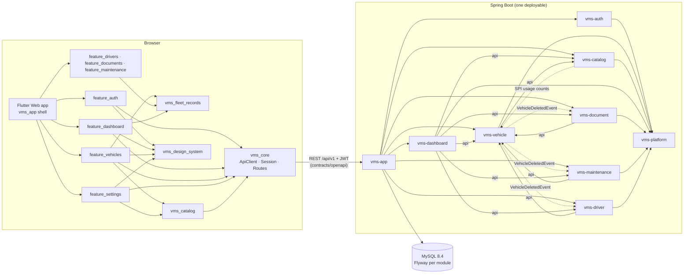

# Architecture

## Big picture

## Why a modular monolith

One deployable, one database, **hard module boundaries** (ADR-0001/0002).
Teams get independent ownership and parallel work today; any module whose
load or release cadence diverges can be extracted into a service later
because it already talks to others only through its `api` package and owns
its tables (no cross-module foreign keys, ADR-0003).

## Request flow (register a vehicle)

1. `VehicleFormScreen` → `VehicleFormViewModel.save()` builds a `VehicleDraft`.
2. `VehicleRepository.create()` → `ApiClient.post('/v1/vehicles')` with the bearer token.
3. Spring Security validates the JWT (HS256), maps `roles` → `ROLE_*`.
4. `VehicleController.register` (`@PreAuthorize(CAN_MANAGE_FLEET)`) → `VehicleService.register`.
5. Service canonicalises the vehicle number, applies the duplicate rule
   (`vehicle_number_key`), validates the type through `CatalogLookup`
   (catalog's public API), saves.
6. Unique index re-checks races; failures become problem documents
   (`DUPLICATE_VEHICLE_NUMBER`, `VALIDATION_FAILED`, …).
7. Client maps `code` → field errors / "Open that vehicle" link.

## Cross-cutting

| Concern | Where |
|---|---|
| Auth | `vms-auth`: `/api/v1/auth/login` issues JWT (8 h); stateless resource server |
| Roles | `ADMIN` (everything), `FLEET_MANAGER` (fleet writes), `VIEWER` (read) — `platform.security.Roles` |
| Errors | RFC 9457 + `code` — `platform.web.GlobalExceptionHandler`; client `ApiError` |
| Auditing | `AuditableEntity`: created/updated at/by, optimistic `version` |
| Uniqueness | Vehicle Number: service rule (`VehicleService.rejectDuplicate`) + `UNIQUE (vehicle_number_key)` on the normalised number |
| Time zone | instants stored UTC; calendar filters use `vms.time-zone` (Asia/Dhaka) |
| Paging | `PageResponse<T>`, max 100 per page, sort whitelist |
| API docs | contract YAML (truth) + springdoc at `/swagger-ui.html` |

## Frontend composition

`lib/main.dart` is the composition root: it creates `AuthSession`,
`ApiClient`, shared repositories and the list of `FeatureModule`s. The router
asks each module for routes and sidebar items, so the shell never changes
when a team adds a feature.
